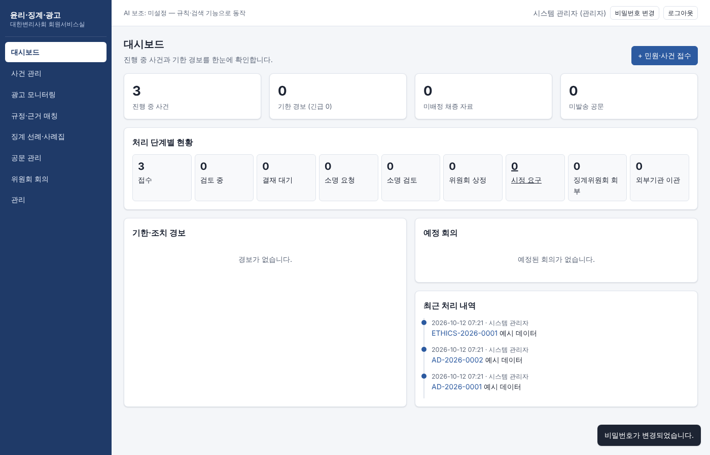

# 윤리·징계·광고 업무지원 시스템 (KPAA 회원서비스실)

민원 접수 → 검토·소명 → 위원회 심의 → 징계/종결까지 한 곳에서 처리하고,
**광고 모니터링 · 규정 해석 · 선례 검색 · 공문 작성 · 회의록 정리**를 AI·규칙 기반으로 줄여 주는 사내 웹 시스템입니다.



## 주요 기능
| 메뉴 | 하는 일 |
|---|---|
| 대시보드 | 단계별 사건 수, 소명·시정 기한/징계시효 경보, 예정 회의, 최근 처리 |
| 사건 관리 | 접수·단계 변경(사유 필수)·기한 자동, 채증(SHA-256), 근거 분석, 공문, 삭제 불가 처리 경과 |
| 광고 모니터링 | 검색어 세트, 광고 문구 즉시 스크리닝(조항 매핑), CSV 일괄 분류, 미배정 채증함 |
| 규정·근거 매칭 | 변리사법·윤리강령·광고규정·위원회 규정 157개 조문, 사실관계 → 조항 매칭, AI 근거 제한 분석 |
| 징계 선례·사례집 | 사례집 PDF/HWP 업로드·색인, 유사 사례 검색, 요지·징계 수위 추출, 선례 DB |
| 공문 관리 | 10종 양식 자동 작성 → 결재 → 발송(SMTP/수동 기록) → .docx |
| 위원회 회의 | 안건·의결, 회의자료 자동 작성, 녹취 요약, 회의록, 의결 결과 사건 반영, 수당 |
| 관리 | 기본 설정, 사용자·권한, 공문 양식, 백업, 감사 로그 |

## 빠른 시작
```bash
./scripts/run_dev.sh     # http://127.0.0.1:8000  (가상 예시 데이터 포함)
```
운영 설치·백업·사용자 조치 항목은 [docs/DEPLOY.md](docs/DEPLOY.md).

## 문서
- [PRD (요구사항·가정)](docs/PRD.md)
- [아키텍처·DB 스키마·API](docs/ARCHITECTURE.md)
- [설치·배포](docs/DEPLOY.md)
- [테스트 결과](docs/TEST_REPORT.md)
- [유지보수·확장 계획](docs/MAINTENANCE.md)

## 폴더 구조
```
ethics-system/
├─ backend/
│  ├─ app/
│  │  ├─ main.py  config.py  db.py  schema.sql  security.py  deps.py  audit.py  seed.py
│  │  ├─ routers/   auth · cases · evidence · knowledge · documents · meetings · admin
│  │  └─ services/  workflow · ad_rules · reg_parser · search · matcher · llm · minutes
│  │                doc_templates · docx_export · mailer · text_extract · storage · backup · case_service
│  ├─ seed/regulations.txt     # 제공받은 HWP에서 추출한 법령·회규 원문
│  ├─ tests/                   # pytest 37개
│  └─ requirements.txt
├─ frontend/                   # index.html · styles.css · js/(app·api·ui·components·views/*)
├─ tests_e2e/ui_flow.mjs       # Playwright 화면 E2E
├─ scripts/                    # run_dev.sh · backup.sh · kpaa-ethics.service
├─ docs/
├─ Dockerfile · docker-compose.yml · .env.example
```

> AI 기능(선택)은 `ANTHROPIC_API_KEY` 설정 시 활성화됩니다. 키가 없어도 규칙·검색 기반 기능은 모두 동작하며,
> AI 응답은 등록된 조문·선례의 ID와 원문 인용이 서버 검증을 통과한 것만 표시됩니다.
